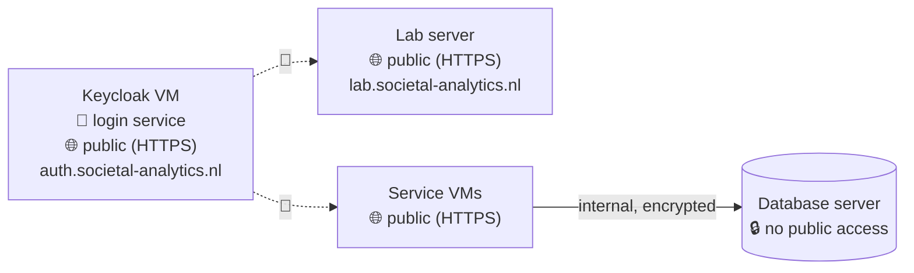

# Overview

The Societal Analytics Lab (VU Amsterdam) runs a small infrastructure for its research: a login service, servers for the tools lab members use, and servers for the research software the lab develops ([AmCAT](./amcat.md), [AnnoTinder](./annotinder.md)). This site describes how that infrastructure is set up and secured, and how our software handles logins. It is written for lab members, for VU IT, and for other research groups with similar needs.

## Map

* **The 🔑 is the lab's login service** (Keycloak). Everything that needs a login uses it: the lab login on the lab server, and the services on the service VMs.
* **🌐 Only HTTPS is public.** Each server has one reverse proxy (Caddy) in front of its services; the services themselves listen only on the server itself or on internal networks. The database server has no public access at all.
* **Backups** of the database server and of Keycloak are still to be decided with VU IT (see [Open points](#open-points)).

## Two kinds of servers

* **Physical servers on VU premises:** the lab server and the database server. Used for work that needs dedicated hardware or a lot of storage.
* **Virtual machines (VMs) from VU SciCloud,** the VU's research cloud ([one.labs.vu.nl](https://one.labs.vu.nl), see [SciCloud](https://rdm.vu.nl/tools/scicloud/)). Used for services that are better off on a server of their own: the login service, and some of the lab's services.

Lab services run on the lab server or on a service VM, whichever suits the service best. An overview of the services: [Hosted services](./servers/services.md).

## Servers

| Server | Kind | Role | Public | Logins | Details |
| --- | --- | --- | --- | --- | --- |
| **Lab server** | Physical, VU premises | The lab's services, all under `lab.societal-analytics.nl` | HTTPS (ports 80 and 443): `lab.` and `*.lab.` | Services: the lab login (lab members only), or the service's own login. Admins: ==TODO: SSH== | [Lab server](./servers/lab.md) |
| **Database server** | Physical, VU premises | Storage for the service VMs: databases and object storage | None | ==TODO== | [Database server](./servers/database.md) |
| **Keycloak VM** | VM, SciCloud | The lab's login service | HTTPS (ports 80 and 443): the login pages at `auth.societal-analytics.nl`; the admin consoles only via VPN | Admins: password and mandatory second factor. SSH: keys only, from the VU network or via the VU SSH gateway | [Keycloak VM](./servers/keycloak.md) |
| **Service VMs** | VMs, SciCloud | Lab services that need a server of their own (currently AmCAT) | HTTPS (ports 80 and 443) | Services: their own login, through Keycloak. SSH: keys only, from the VU network or via the VU SSH gateway | [Service VMs](./servers/service-vms.md) |

IP addresses and the admin hostname of Keycloak are not published here.

**On every server:**

* One reverse proxy (Caddy) with certificates from Let's Encrypt is the only way in. Services listen on `127.0.0.1` or on internal networks.
* Docker containers bypass a server's firewall, so we follow strict rules for them ([Docker warnings](./install/docker.md)).
* Software versions are pinned and upgraded deliberately; the operating system installs security updates automatically.
* Secrets are only on the server they are used on, readable only by the account that runs the service.

How the servers are set up: [Installation guides](./install/vm.md). Why they are set up this way: [Decisions](./decisions.md).

## Open points

* **Backups:** an encrypted, off-site (or at least off-server) backup for the database server and Keycloak, to be agreed with VU IT. Keycloak's daily database dumps are currently kept on the VM itself ([Backups](./install/keycloak.md#9-backups)).
* **The lab server:** ==TODO: operating system updates, SSH access, the move of the services to their addresses under `lab.`, and of their data to `/srv`.== Its backup is `/srv` plus the `.env` files in `/opt`.
* **The database server:** ==TODO: what it stores, and how the service VMs connect to it.==
* **Keycloak's address:** Keycloak still runs at an older address; ==TODO: move it to `auth.societal-analytics.nl`.==
* **The VM firewall:** one check of the VM firewall together with Docker is still to be done ([Docker and the VM firewall](./install/vm.md#docker-and-the-vm-firewall)).
* **Privacy statement and acceptable use policy:** drafts, to be reviewed by the VU privacy officer ([Privacy statement](./policies/privacy.md), [Acceptable use policy](./policies/aup.md)).
* **Retention** of the inputs and outputs of the lab services (e.g. audio and transcripts): ==TODO== (see the privacy statement).
