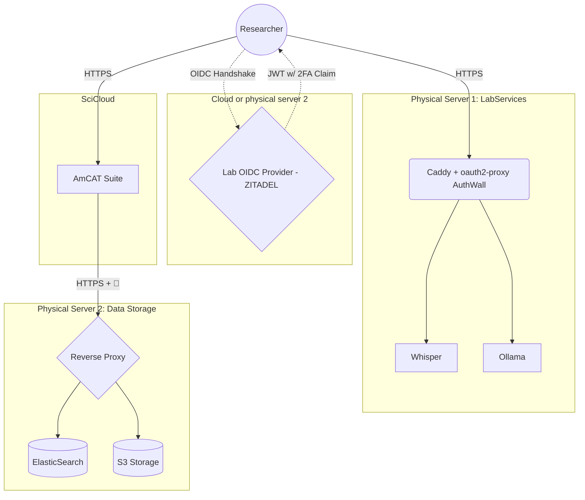

# Lab Infrastructure Registry

This registry serves as the authoritative map for the lab's physical hardware and the research services they host.

---

## 🌐 Infrastructure Landscape
This diagram maps our primary physical servers to the high-level services accessible to researchers.

---

## 🖥️ Physical Assets & Service Ownership

| Physical Server | Hosted Services | Access Level | Primary Purpose |
| :--- | :--- | :--- | :--- |
| **SciCloud** | **[AmCAT](./amcat.md)** | Public / Authenticated | Web Application & API for storing, managing and sharing data |
| **Data Storage** | **ElasticSearch**, **S3** | Internal Only | Backend storage for text and large files. |
| **LabServices** | **Whisper**, **Ollama** | Authenticated | GPU-accelerated AI inference & transcription. |
| ==TODO: server for the lab OIDC provider== | **Lab OIDC provider** (ZITADEL) | Lab members | Identity provider for lab services, with 2FA. |
| ==TODO: separate VM or ZITADEL Cloud== | **Shared OIDC provider** (ZITADEL) | Public (self-service organizations) | [Shared provider](./auth-install.md#option-1-our-shared-oidc-provider) for other teams hosting AmCAT or AnnoTinder without sensitive data. Kept separate from the lab OIDC provider. |

---

## 🔐 Security Considerations
* **Edge Security:** No service is exposed via plain HTTP. All traffic is TLS-encrypted.
* **Identity:** We use a "Zero Trust" approach: services without their own OIDC login sit behind Caddy with oauth2-proxy (forward auth), which checks the OIDC session before traffic reaches the service. Our own software (AmCAT, AnnoTinder) follows the [Authentication standard](./auth.md).
* **2FA:** Multi-factor authentication is required for all researcher logins via the lab OIDC provider (ZITADEL).
* **Resilience:** All servers perform daily off-site backups to the University NAS.
