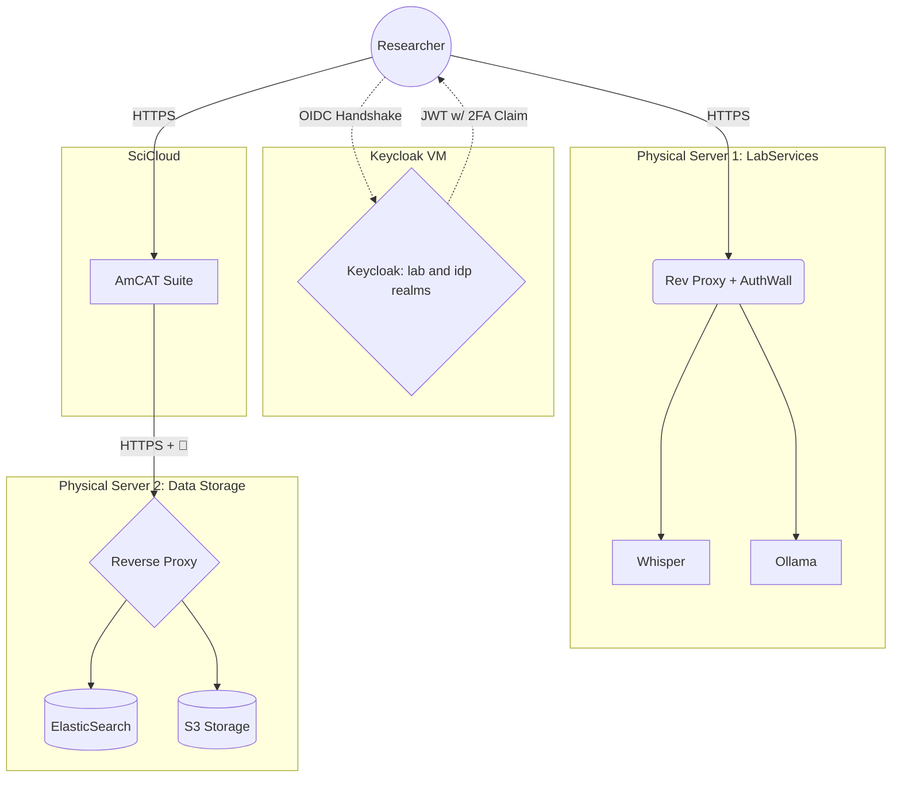

# Infrastructure overview

What the lab runs, and where. For the lab (how it fits together) and for IT (see also the [security overview](./it.md)).

## Map

## Servers

| Server | Kind | What runs on it | Reachable | Details |
| --- | --- | --- | --- | --- |
| **Keycloak VM** | VM on the VU research cloud | Keycloak (the realms `master`, `lab` and `idp`), Caddy, PostgreSQL, the email relay | The login pages from anywhere; the admin console only from the university network | [Keycloak deployment](./keycloak-deploy.md), [University VMs](./vm.md) |
| **Lab server** (LabServices, the LLM server) | Physical server | The lab's services (Whisper, Ollama and other tools), all under `lab.`, with an overview page at `lab.`; Caddy and the lab login (the AuthWall) | Only through Caddy (HTTPS); services without their own login behind the lab login | [Lab server](./lab-server.md) |
| **SciCloud** | ==TODO== | AmCAT | From anywhere (HTTPS), with its own login | [AmCAT](./amcat.md) |
| **Data storage** | Physical server | Elasticsearch, S3 storage | Internal only (for AmCAT) | ==TODO== |
| ==TODO: AnnoTinder server== | ==TODO== | AnnoTinder | ==TODO== | [AnnoTinder](./annotinder.md) |
| ==TODO: CCR== | ==TODO== | ==TODO== | ==TODO== | ==TODO== |

How to set up a server: [University VMs](./vm.md) (a VM), [Lab server](./lab-server.md) (apps on the lab server), and [Docker on our servers](./docker.md) (rules for all servers).

## Software

| Software | Developed by us, or hosted | For | Runs on | Details |
| --- | --- | --- | --- | --- |
| **AmCAT** | Developed by us | Researchers: storing, managing and sharing research data | SciCloud (our server); others can host it too | [AmCAT](./amcat.md) |
| **AnnoTinder** | Developed by us | Researchers: annotating research data | ==TODO== | [AnnoTinder](./annotinder.md) |
| **Scriptorium** | Developed by us | ==TODO== | ==TODO== | ==TODO== |
| **Keycloak** | Hosted | The lab's logins: the lab's infrastructure (`lab`) and our own servers (`idp`) | Keycloak VM | [Keycloak setup](./keycloak.md) |
| **Whisper** | Hosted | Lab members: transcription of audio | Lab server, behind the lab login | [Lab server](./lab-server.md) |
| **Ollama** | Hosted | Lab members: language models | Lab server, behind the lab login | [Lab server](./lab-server.md) |
| **CCR** | ==TODO== | ==TODO== | ==TODO== | ==TODO== |

Our own software follows the [Authentication standard](./auth.md). Teams that host it themselves: [Hosting our software](./auth-install.md).
