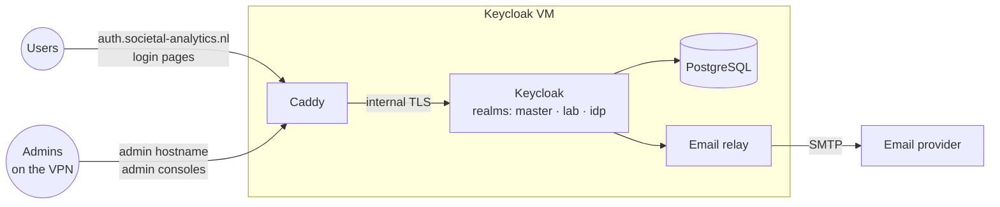

# Keycloak VM

The lab's login service: [Keycloak](https://www.keycloak.org), an open-source identity provider, on a VM of its own in VU SciCloud. The lab server and the lab's services use it for their logins, so they never handle passwords or second factors themselves. Users log in at `auth.societal-analytics.nl`.

## Map

* **Two hostnames.** `auth.societal-analytics.nl` is public, but only serves the login pages and what apps need to verify logins; everything else returns 404. The admin consoles, the admin API and the logins of the `master` realm are only on a separate admin hostname, reachable only from the VPN.
* **Caddy** handles HTTPS with certificates from Let's Encrypt, decides which paths are public, and forwards requests to Keycloak over a second TLS connection with an internal certificate that only Caddy trusts. So traffic is encrypted all the way, as Keycloak's [reverse proxy guide](https://www.keycloak.org/server/reverseproxy) recommends.
* **PostgreSQL** is only reachable by Keycloak, on a network without internet access.
* **The email relay** sends all email of Keycloak to the email provider. It is the only place with the provider's password, and it caps the email of the whole installation.

==TODO: Keycloak still runs at an older address; it moves to `auth.societal-analytics.nl`.==

## Three realms

A realm in Keycloak is a separate login: its own users, apps, settings and admins. Users of one realm don't exist in another.

| Realm | For | Login | Who can join |
| --- | --- | --- | --- |
| **master** | Administering Keycloak itself | Password and a mandatory second factor | Only the administrators |
| **lab** | The lab's own infrastructure: the [lab login](./lab.md) on the lab server | Password and a mandatory second factor | Lab members and invited collaborators, added by the lab's admins |
| **idp** | The lab's servers for researchers, such as AmCAT and AnnoTinder | Password, Google or GitHub; second factor optional, but required by our servers for sensitive actions | Anyone (an account gives no access by itself) |

* **master** has no email and no external logins, so admin access never depends on an inbox or someone's Google account. Lost access is recovered via the server itself.
* **lab** uses institutional email addresses, so there is no Google or GitHub login. Institutional login (via SURF SRAM) may be added later ([Decisions](../decisions.md#later)).
* **idp** is the one login for all of the lab's servers for researchers ([below](#the-idp-realm-one-login-for-the-labs-servers)).

All realms show the lab logo and name on their login pages, with a subtitle ("Administration", "Lab account", "Identity provider"), so users know whose login this is; in `idp`, the consent screen names the app that asks for access.

The realms are set up from realm files in the repository [deploy-keycloak](https://github.com/vu-societal-analytics/deploy-keycloak) (`realms/`), which Keycloak imports when it starts, for realms that don't exist yet. The files document the configuration, including the login flows, and make it easy to set up the realms again ([Realms](../install/keycloak.md#7-realms)).

## How users log in

| | master | lab | idp |
| --- | --- | --- | --- |
| **Sign in with** | Password, or only a passkey | Password, or only a passkey | Password, only a passkey, Google or GitHub |
| **Second factor (2FA)** | Mandatory | Mandatory | Optional |
| **First time, or forgot password** | Not possible (no email): another admin, or the VM | Email link, the second factor (if any), a new password, and in | Same as lab |
| **Lost second factor** | Recovery code, another admin, or the VM | Recovery code, or a lab admin | Recovery code, or one of our admins |

In all realms, the email address is the username. A second factor is an authenticator app (one-time codes, OTP), a passkey or security key, or a recovery code. Tokens contain `amr`: `pwd` for a password, `mfa` for a second factor. Servers that run our software check `mfa` for sensitive actions (see [Two-factor authentication](../auth.md#two-factor-authentication-2fa)).

**Why:**

* **Mandatory 2FA in master and lab,** because these accounts give access to our infrastructure. **Optional in idp,** to keep the barrier low for students and collaborators: our servers require `mfa` for sensitive actions (step-up).
* **A passkey alone counts as two factors:** the device, plus a fingerprint, face or PIN to unlock it. Passkeys can't be phished: they only work on our own domain.
* **Email never replaces the second factor.** After the email link, users with a second factor must enter it before they can choose a new password, so someone who gets into their inbox can't get in. (Keycloak's default reset logs the user in after the new password without the second factor, and lets them set up a new authenticator app, so an inbox would be enough to take over an account. We changed that.)
* **master has no email and no external logins,** so admin access never depends on an inbox or someone's Google account.

### Step by step

* **First time (lab):** lab members are added by the lab's admins, without a password (see [Adding lab members](../install/keycloak.md#adding-lab-members)). The login page says **Sign in with your lab account**. They click **First time, or forgot your password?**, enter their email address, and click the link in the email (**Set your lab password**, valid for 30 minutes). Then, in one go: choose a password, fill in their name, set up an authenticator app, save the recovery codes, and they are logged in. Others get no email (the page says the same to everyone).
* **Password:** email address and password, then the second factor if the user has one (**Try another way** offers the user's other second factors, e.g. a recovery code). In master and lab, users without a second factor set up an authenticator app at their first login, and get recovery codes right after: shown once, to save somewhere safe. (The token of that first login has `amr` `pwd` only, because setting up an app doesn't count as using it. A server that requires `mfa` asks for a code once more.)
* **Passkey:** **Sign in with Passkey** on the login page (or the browser's suggestion in the email field), then the fingerprint, face or PIN. No password and no other factor. Users register a passkey in the account console (**Account security → Signing in**), which offers it twice. A passkey under **Passwordless** is for signing in with only the passkey. A passkey under **Two-factor authentication** is a second factor after the password. Both work.
* **Google or GitHub (idp only):** the first time, an account is created with the address from Google or GitHub (Keycloak verifies a GitHub address itself). If an account with that address already exists, Keycloak shows **Account already exists**: the user links the two by clicking a link sent to the address, or by entering the account's password (and its second factor; after linking it is asked once more, only this first time). After that, users with a second factor are asked for it after Google or GitHub. `amr` has no `pwd` for these logins: `mfa`, or empty.
* **Setting up 2FA later (idp):** in the account console (**Account security → Signing in**). After setting up an authenticator app, Keycloak asks for recovery codes right away. After adding a passkey it doesn't: users who only use passkeys should set up recovery codes there too, or register a second passkey.
* **Forgot password (lab, idp):** the same link on the login page, then a link by email (valid for 30 minutes). Users with a second factor enter it first (or a recovery code), then choose a new password, and they are logged in.
* **Remember me (lab):** users who tick it stay logged in on that device for up to 30 days (7 days without using it). Without it, the session at Keycloak ends after 30 minutes without use. Sensitive actions in our software still ask for the second factor again (step-up).
* **Lost second factor:** log in with a recovery code (**Try another way → Recovery Authentication Code**; each code works once). Then, in the account console, set up a new authenticator app or passkey, and new recovery codes. Without recovery codes: in lab, a lab admin removes the lost factor after checking who the user is (not by email alone: the inbox may be the problem); in idp, one of our admins does the same; in master, another admin, or the VM ([Recovering admin access](../install/keycloak.md#recovering-admin-access)). How: [A user lost their second factor](../install/keycloak.md#a-user-lost-their-second-factor).
* **Time:** each page of the login (e.g. setting up the authenticator app, or saving the recovery codes) may take 30 minutes. After that, Keycloak says **Your login attempt timed out** and the login starts again.

The flows behind these steps: [`realms/README.md`](https://github.com/vu-societal-analytics/deploy-keycloak/blob/main/realms/README.md) in [deploy-keycloak](https://github.com/vu-societal-analytics/deploy-keycloak).

## The idp realm: one login for the lab's servers

`idp` is the central login of the lab's own servers: our AmCAT and AnnoTinder servers, and other tools later. Users have one account for all of them.

* **Anyone can create an account,** with an email address, or with Google or GitHub. An account gives no access by itself: each server decides what a user may do, with roles given to an email address or a user (see [Authorization](../auth.md#authorization)). So students and collaborators sign up themselves when a project gives them access, instead of waiting for an admin.
* **Only the lab's admins add servers** (clients), in the admin console ([step 8 of the installation guide](../install/keycloak.md#8-clients-for-our-deployments)). A client policy turns on consent and PKCE, and refuses unsafe redirect URIs, so a client can't be created with a mistake. Users always see a consent screen with the server's name before it gets their name and email address.
* **Servers get only what they need:** the email address (and whether it is verified), whether the user signed in with 2FA, and the login time; the name only if the server asks for it (the scope `profile`, which our own software doesn't request). No roles. The consent screen says exactly that, in plain words: *"This app will be able to: see your email address; see whether you signed in with two-factor authentication"*, plus *"see your name"* for a server that asks for it.
* **Not a service for others.** Teams that host our software themselves use their own provider, ideally their institution's (see [Authentication provider](../auth-install.md)). The lab's setup, described here, can serve as an example for teams that run their own.

## More realms

New realms are cheap, and isolated from each other:

* **Isolated realms for the lab's own servers,** e.g. one per AmCAT or AnnoTinder server the lab hosts, so that their users don't share accounts with other servers.
* **A realm for a lab member** (or their team), with its own admin, who manages it in the admin console of that realm only.

Every new realm can send email through the email relay (host `mail-relay`, port 587, no login, the lab's sender address). The relay holds the credentials of the email provider: a realm admin can send email through it, but can't read the password or send it to another server, and the relay caps the email of the whole installation.

## Security in short

* **Encrypted all the way:** a public certificate between browsers and Caddy, an internal one between Caddy and Keycloak ([Map](#map)).
* **Only the login paths are public** (`/realms/`, `/resources/`, `/.well-known/`, as Keycloak [recommends](https://www.keycloak.org/server/reverseproxy#_exposed_path_recommendations)).
* **Admin access only via the VPN:** the admin hostname (the admin consoles, the admin API and the `master` realm) only accepts the VPN's IP ranges, for all realms. A realm for a team outside the university can get an exception for its own admin console. The ranges are only configured on the VM.
* **Mandatory second factor** for administrators (`master`) and lab members (`lab`); a password reset by email never replaces the second factor ([How users log in](#how-users-log-in)).
* **The email relay:** Keycloak sends all email through it without a password, the relay only accepts our sender address, and it caps the email for the whole installation. Together with a limit per IP address on the requests that send email, this protects the monthly quota of the email provider.
* **Clients with safe defaults:** in `idp`, a client policy turns on consent and PKCE for every client the lab's admins create, and refuses unsafe redirect URIs. It prevents mistakes; it doesn't stop an admin who wants otherwise.
* **Secrets an admin can use but not take:** the email provider's password is only in the relay, and the Google and GitHub secrets are stored masked in Keycloak, which refuses to send them to another address without entering them again. This is an extra layer, not a wall: admins can send email and use these logins, and a real admin can always replace the secrets, but not read them out.
* **Brute force detection, a password policy, and login and admin events** in all realms, and daily database backups ([Backups](../install/keycloak.md#9-backups)).

Why it is set up this way: [Decisions](../decisions.md).
