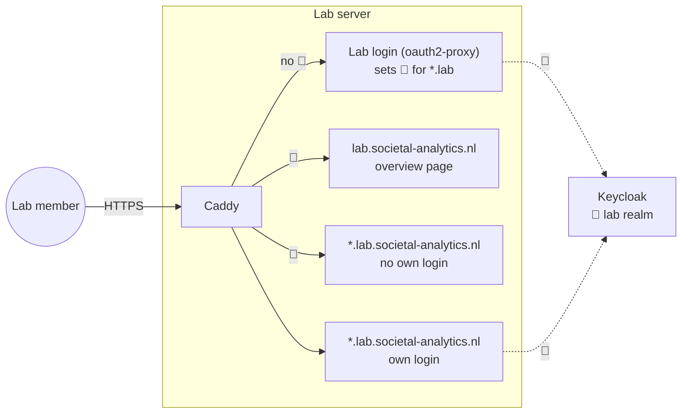

# Lab server

A physical server on VU premises that hosts the lab's services for its members, such as transcription (Whisper) and language models (Ollama). Every service has an address under `lab.societal-analytics.nl`, and `lab.societal-analytics.nl` itself is an overview of the services. Which services run here: [Hosted services](./services.md).

## Map

* **Caddy** is the only thing reachable from outside. It handles HTTPS (certificates from Let's Encrypt), and sends every request to the right service.
* **The lab login** (the AuthWall) protects services without a login of their own, and the overview page. Visitors without its login cookie (🍪) are sent to the lab's login service (the `lab` realm of [Keycloak](./keycloak.md)), so only lab members get in: an account with a password and a mandatory second factor. After that login, the lab login sets the cookie for all of `*.lab`. A service can be restricted further, to one group of members.
* **Services with their own login** (e.g. a chat interface for the language models) are reached directly through Caddy, and log users in through Keycloak's `lab` realm themselves.
* **The rule:** every service under `lab.` either sits behind the lab login, or has its own login through Keycloak. Never a separate password or token, so lab members have one account, with a second factor, for everything.
* **The services** listen only on the server itself (`127.0.0.1`), so they can't be reached around Caddy. Each one lives in its own directory, owned by a system account without a login.

## The lab zone: everything under `lab.`

Every service the lab runs for its members gets an address under `lab.societal-analytics.nl`, such as `whisper.lab.societal-analytics.nl`, with or without its own login. The DNS has two records for this server, `lab` and `*.lab`, so a new service needs no DNS change.

The lab login is **one login cookie for the whole zone**: after logging in once, members can use every service behind the lab login, and signing out ends the login for all of them.

!!! warning "Only the lab's own services under `lab.`"
    The browser sends the login cookie to **every** address under `lab.societal-analytics.nl`. Whoever receives it can use it to get into the services behind the lab login, as that user. So only services the lab runs on its own servers may be put under `lab.`, never a site hosted by someone else (an external website host, a SaaS product, a student's own server).

The lab's website (`societal-analytics.nl`, hosted on GitHub Pages) is outside the zone, and never receives the cookie. Services with their own login under `lab.` do receive it, but don't use it; they run on the same server, from where they could reach the other services anyway. Why one cookie for the zone, rather than one per service: [Decisions](../decisions.md#all-lab-services-under-lab-with-one-login-cookie-for-the-zone).

## Signing out, and inactivity

* **Sign out:** the **Sign out** button on the overview page, or `/oauth2/sign_out` on any service behind the lab login. It ends the login for all services and the session at Keycloak.
* **Inactivity:** members who don't use any service behind the lab login for 2 hours have to log in again. Active members stay signed in: the lab login checks the session with Keycloak every 10 minutes while they work, and a long request (e.g. a large upload) is never cut off.
* **Remember me:** members who tick it when they log in stay signed in on that device for up to 7 days without activity.
* **A removed member** (or one removed from a group) loses access within 10 minutes. Everyone can be signed out at once, e.g. after a stolen laptop.

## Setup

How the server, the lab login and new services are set up: [Installation: lab server](../install/lab-server.md).
